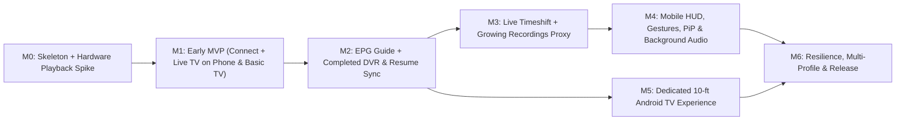

# Implementation Plan — MuxGrid (Lightweight Tvheadend Android Client: Phone + TV)

This plan is written for any human engineer or coding agent to implement end-to-end. It specifies **architectural decisions, module contracts, iterative MVP-first milestones, acceptance criteria, and known pitfalls**, while intentionally leaving internal class layouts and boilerplate flexible so implementers can use idiomatic patterns without hitting artificial dead ends.

---

## 1. Architectural Decisions (The "Why")

### 1.1 Protocol, Auth & Profile Split (Best-in-Class Hybrid)

Use **HTSP (port `9982`)** for control, real-time state, authentication tickets, server-side resume sync, and growing recordings; use **HTTP (port `9981`)** with Tvheadend's **`pass` (MPEG-TS)** profile for live media streaming and **`matroska` (`.mkv`)** for DVR storage (subject to the M0 growing-MKV seek check).

**Unified Media Auth Strategy:** Tvheadend HTTP tickets (`getTicket`) expire after **300 s** by default (reusable within that window; already-open streams stay alive, but subsequent HTTP `Range` seeks on long recordings or live reconnects fail with `401`). To avoid `401` errors, extra server-side persistent-auth tokens, or FFmpeg Digest-auth quirks, **route all `libmpv` media URLs through an in-process `LocalMediaProxy` (`127.0.0.1:<ephemeralPort>/<sessionToken>/...`)** that transparently obtains and refreshes HTSP `getTicket` tokens per upstream request (and retries once on `401`).

| Function | Mechanism | Why |
| :--- | :--- | :--- |
| **Channels, Tags, EPG, DVR** | **HTSP (`9982`)** `enableAsyncMetadata` | Single persistent TCP socket with real-time push updates (`channel*`, `tag*`, `event*`, `dvrEntry*`). Zero polling, instant startup, live recording status updates. *(Autorec rule editing is post-v1; autorec-created DVR entries still appear in Recordings.)* |
| **Authentication** | **HTSP SHA-1 challenge-response + `getTicket` via `LocalMediaProxy`** | Password is never sent in plaintext URLs or forwarded to `libmpv`. `LocalMediaProxy` auto-refreshes short-lived tickets before the 300 s expiry so long recording seeks and reconnects never `401`, with zero extra Tvheadend config. |
| **Live TV & Radio Playback** | **HTTP `pass` (MPEG-TS)** via `LocalMediaProxy` → `?ticket=...&profile=pass` | Raw DVB broadcast pass-through with zero server transcoding (<1 s same-mux zap on LAN). Preserves all audio tracks, DVB subtitles, and radio streams. Proxy also gives deterministic teardown on single-tuner zaps and clean 0-byte empty-reply conflict detection. |
| **Live Pause & Rewind (Timeshift)** | **`libmpv` disk-backed demuxer ring buffer** (`cache=yes`, `demuxer-seekable-cache=yes`, `cache-on-disk=yes`) | Instant 0 ms scrub within the buffered live window without building a fragile HTSP `muxpkt` elementary-stream bridge. Both `demuxer-max-bytes` (pause headroom) and `demuxer-max-back-bytes` (rewind headroom) are sized to the target window. |
| **Completed Recordings** | **HTTP `/dvrfile/<id>?ticket=...` via `LocalMediaProxy`** (`.mkv` DVR profile) | Direct byte-range seeking with native Matroska cues; ticket auto-refresh prevents 300 s seek timeouts; zero conflict with existing Jellyfin `TV Recordings` library. |
| **In-Progress (Growing) Recordings** | **HTSP `fileOpen` / `fileRead` / `fileStat`** via `LocalMediaProxy` **tail-follow** handler | Tvheadend's HTTP `/dvrfile/<id>` snapshots `Content-Length` at open time. The proxy replies with `Accept-Ranges: bytes` + `Content-Range: bytes X-Y/*` (unknown total) and polls `fileStat` at the write head so `libmpv` never hits premature EOF or `416`. |
| **Recording Resume / Watched State** | **Server-side HTSP `playposition` (s) & `playcount`** via `updateDvrEntry` (v26/27+) | Automatically syncs "Continue Watching" and watched state between Phone and Android TV. Local DataStore fallback only for read-only users without `ACCESS_HTSP_RECORDER`. |
| **Channel Picons** | **Custom Coil 3 `Fetcher`**: HTSP `fileOpen("imagecache/...")` primary; authenticated HTTP (`Digest`/`Basic`) fallback | Normalizes `imagecache/<id>` (HTSP v15+), `/imagecache/<id>` (v8–14), and raw `http(s)://` URLs. Falls back to HTTP when the user lacks `ACCESS_HTSP_RECORDER` (required by HTSP `fileOpen`). |

> See [docs/PROTOCOL.md](./docs/PROTOCOL.md) for wire details and [docs/SERVER_SETUP.md](./docs/SERVER_SETUP.md) for required Tvheadend server settings.

### 1.2 Playback Engine: `libmpv` + Media3 `MediaSessionService`

- **Core Decoder/Renderer (`io.github.abdallahmehiz:mpv-android-lib:0.2.1`):**
  European DVB-T broadcasts (such as Hungarian MindigTV) deliver **`1440x1080i` interlaced H.264**, **`MP2` / `AC3` / `AAC` audio**, and **bitmap DVB subtitles (`DVBSUB`)**.
  - **Why `mpv-android-lib` (and NOT `dev.jdtech.mpv:libmpv`):** Both Maven Central AARs bundle `h264`, `hevc`, `mpeg2video`, `mp2`, `ac3`, `eac3`, `aac`, `aac_latm`, `dvb_subtitle`, `mpegts`, `matroska`, and `http/https`, **but `dev.jdtech.mpv:libmpv:1.1.0` compiles FFmpeg with `--disable-filters` and strips `bwdif`/`yadif` completely**. `io.github.abdallahmehiz:mpv-android-lib:0.2.1` (JNI `is.xyz.mpv.MPV` / `MPVSession`) retains `bwdif`/`yadif` so software deinterlacing actually works. *(License note: its bundled `libavutil.so` is compiled with `--enable-gpl --enable-version3`, making distributed APKs **GPL-3.0-or-later**.)*
  - **Video Output & Deinterlacing:**
    - Always use **`vo=gpu` + `gpu-context=android` + `opengl-es=yes`** on a **`SurfaceView`** so `DVBSUB` bitmap subtitles and OSD render cleanly under both `hwdec=mediacodec` and `hwdec=mediacodec-copy`. *(Treat `vo=mediacodec_embed` only as an opt-in fallback — it disables `DVBSUB` and OSD.)*
    - **`hwdec=mediacodec` (`vo=gpu`)** is zero-copy and keeps `DVBSUB`, **but skips mpv's filter chain (`deinterlace=yes` has no effect)**, relying on SoC/TV MediaCodec internal deinterlacing.
    - **`hwdec=mediacodec-copy` + `deinterlace=yes`** runs FFmpeg's **`bwdif`** on the CPU — clean on modern phones, but must be benchmarked on the TCL C635's quad-core Cortex-A55 @ 1.3 GHz in **M0** before locking the TV default preset. Expose a Settings toggle (`Auto / Hardware Zero-Copy / Hardware Copy + Deinterlace`).
  - **ABI Splits:** Configure Gradle ABI splits (`armeabi-v7a`, `arm64-v8a`) — the TCL C635 (Realtek `RTD2851` / `RT51M`, Android TV 11) commonly runs a **32-bit-only `armeabi-v7a` userland**, and shipping all 4 ABIs bloats the APK by ~75 MB.
- **System Integration (`androidx.media3:media3-session` + Explicit Platform Locks):**
  Wrap `PlaybackEngine` inside a **`MediaSessionService`** (using a lightweight `SimpleBasePlayer` adapter) for foreground service lifecycle, system media notification, lock-screen controls, Bluetooth/headset media keys, and clean **Picture-in-Picture (PiP)** transitions on phone.
  - **Important:** Media3's `SimpleBasePlayer` / `MediaSessionService` does **NOT** automatically manage audio focus, noisy audio, or wake/Wi-Fi locks (those live in `ExoPlayerImpl`). The service/engine **must explicitly implement**:
    1. `AudioManager.requestAudioFocus(AudioFocusRequest)` / `abandonAudioFocusRequest` (duck/pause/resume).
    2. A `BroadcastReceiver` for `AudioManager.ACTION_AUDIO_BECOMING_NOISY` (pause on headphone/BT disconnect).
    3. `WifiManager.WifiLock` (`WIFI_MODE_FULL_LOW_LATENCY` / `WIFI_MODE_FULL_HIGH_PERF`) + `PowerManager.PARTIAL_WAKE_LOCK` during active background audio/radio playback so Wi-Fi power-save never stalls screen-off streams.
- **Abstraction Boundary:**
  Define a clean `PlaybackEngine` interface and transport-agnostic `PlaybackState` (`positionMs`, `durationMs`, `liveEdgeOffsetMs`, `bufferWindowMs`, `isTimeshiftSeekable`) in `:core:player`. Neither UI modules nor repositories may import `libmpv` classes directly. Inside `:core:player`, isolate live stream URL resolution and timeshift seeking behind an internal `LiveStreamStrategy` interface (`HttpPassStrategy` in v1 using `LocalMediaProxy` + `libmpv` cache; no HTSP `subscribe` implementation or UI in v1, but a future `HtspSubscribeStrategy` can plug in later without redesigning the UI or data layers).

### 1.3 Single Unified APK (Phone/Tablet + Android TV)

Build **one codebase** (with ABI-split APKs: `armeabi-v7a` and `arm64-v8a`) containing both form factors:
- Declare both `LAUNCHER` and `LEANBACK_LAUNCHER` intent filters, `android:banner="@drawable/tv_banner"` (`320×180`), `<uses-feature android:name="android.software.leanback" android:required="false" />`, and `<uses-feature android:name="android.hardware.touchscreen" android:required="false" />`.
- Detect form factor once at entrypoint (`PackageManager.FEATURE_LEANBACK` or `UiModeManager.currentModeType == Configuration.UI_MODE_TYPE_TELEVISION`) and mount either the TV root composable (`:feature:tv`) or Phone/Tablet root composable (`:feature:mobile`).
- Share 100% of protocol, state, repositories, playback engine, and design tokens across both targets.

---

## 2. Modern Tech Stack (Verified 2026-11-20 Baseline)

| Layer | Pinned Stable Choice | Notes |
| :--- | :--- | :--- |
| **Language** | Kotlin `2.4.21` + Coroutines + `StateFlow` | Strict concurrency; zero RxJava. |
| **Build** | AGP `9.5.2` + Gradle Kotlin DSL + Version Catalog (`libs.versions.toml`) | Multi-module builds, ABI splits (`armeabi-v7a`, `arm64-v8a`), Java 17 bytecode target. |
| **SDK Targets** | `minSdk = 28`, `compileSdk = 36`, `targetSdk = 36` | App ID `io.github.corebonts.muxgrid`. Covers Android TV 11 (API 30) through Android 17 (Poco F8 Ultra) while keeping implicit local-network access until opting into `targetSdk = 37`. |
| **Mobile UI** | Jetpack Compose BOM `2026.11.01` (Compose `1.13.0`, Material 3 `1.5.0`) + Haze `2.1.0` | Haze (`dev.chrisbanes.haze:haze:2.1.0`) for non-video backdrop blur; translucent dark scrims over `SurfaceView` video (see Pitfall #10). |
| **TV UI** | Compose for TV (`androidx.tv:tv-material:1.1.0`) | Never use legacy Leanback XML (`androidx.leanback`). |
| **Navigation** | Type-safe Navigation Compose (`androidx.navigation:navigation-compose:2.10.2`) | Stable `@Serializable` routes. |
| **Playback Core** | `io.github.abdallahmehiz:mpv-android-lib:0.2.1` | KMP Android artifact (`mpv-android-lib-android:0.2.1`, JNI `is.xyz.mpv.MPV`); retains `bwdif`/`yadif`; GPL-3.0-or-later. |
| **Media Session / Background** | Jetpack Media3 (`androidx.media3:media3-session:1.11.1`) | Foreground `MediaSessionService` (`FOREGROUND_SERVICE_MEDIA_PLAYBACK`) + custom AudioFocus / Noisy / WifiLock / Partial WakeLock. |
| **Images (Picons)** | Coil 3 (`io.coil-kt.coil3:coil-compose:3.6.3` + `coil-network-okhttp:3.6.3`) | Custom HTSP `fileOpen` Fetcher + authenticated OkHttp fallback; aggressive disk + memory cache. |
| **Local Storage & Secrets** | Jetpack DataStore (`1.3.0`) + Google Tink (`com.google.crypto.tink:tink-android:1.24.0`) | `androidx.security:security-crypto` is deprecated. Use Tink `AndroidKeysetManager` (Keystore-backed AEAD) to encrypt recoverable passwords needed for HTSP SHA-1 auth. |
| **DI** | Lightweight manual container / Koin (pure-Kotlin constructor injection) | Keeps `:core:htsp` and `:core:model` pure JVM with zero annotation-processor bloat. |
| **Testing** | JUnit 5 / Kotlin Test + Coroutines Test + Turbine | Pure JVM tests for HTSP binary codec, shadow-store resync, and `LocalMediaProxy` (ticket refresh + tail-follow). |

---

## 3. Module Map & Boundaries

Keep the dependency graph strictly acyclic and shallow:

```text
:app                 (AndroidManifest, MainActivity, DI graph, form-factor router)
 ├── :feature:mobile (Phone & tablet screens, touch player HUD, PiP, mini-player)
 ├── :feature:tv     (10-foot Compose for TV screens, D-pad player HUD, quick zap OSD)
 ├── :core:designsystem (Colors, typography, scrims/glass surfaces, adaptive tokens, shared badges)
 ├── :core:player    (PlaybackEngine interface, MpvPlaybackEngine, LocalMediaProxy, MediaSessionService)
 ├── :core:data      (TvheadendRepository, reactive in-memory store, DataStore + Tink prefs, Coil picon fetcher)
 ├── :core:htsp      (PURE JVM Kotlin: binary htsmsg codec, TCP socket client, heartbeat/resync, RPCs)
 └── :core:model     (PURE JVM Kotlin: immutable domain models & enums)
```

### Key Store Decision (Keeping It Lightweight)
For typical homelab setups (15–200 channels, ~7 days of EPG), holding live HTSP state in a **reactive in-memory `StateFlow` store** inside `:core:data` gives instantaneous filtering, searching, and Now/Next lookups with minimal RAM and zero SQLite schema migrations. On reconnect, `enableAsyncMetadata` populates a **shadow store** and swaps atomically on `initialSyncCompleted` so deletions are never missed and the UI never blanks. Persist only **server profiles (Tink-encrypted credentials), favorites, playback preferences, and read-only resume fallback** in DataStore.

---

## 4. Iterative, MVP-First Implementation Milestones

Milestones are structured to **de-risk hardware first (M0)**, ship a **usable Live TV MVP as early as possible (M1)**, and then layer features iteratively (M2–M6). Each milestone must be independently tested on real hardware before moving to the next.



*(Once M2/M3 shared pieces are stable, M4 Mobile Polish and M5 Dedicated TV UI can proceed in either order or in parallel.)*

---

### Milestone 0 — Project Skeleton & Hardware Playback Spike (De-Risking)
*Goal: Eliminate all unknown hardware, ABI, decoder, and growing-MKV risks before building app architecture.*
- Scaffold multi-module Gradle project (`libs.versions.toml`, Kotlin `2.4.21`, AGP `9.5.2`, Compose BOM `2026.11.01`, Compose for TV `1.1.0`, `io.github.abdallahmehiz:mpv-android-lib:0.2.1`, ABI splits for `armeabi-v7a` and `arm64-v8a`).
- Configure unified `AndroidManifest.xml`:
  - `LAUNCHER` + `LEANBACK_LAUNCHER`, `android:banner="@drawable/tv_banner"`, `<uses-feature android:name="android.software.leanback" android:required="false" />`, `<uses-feature android:name="android.hardware.touchscreen" android:required="false" />`.
  - `FOREGROUND_SERVICE_MEDIA_PLAYBACK`, `supportsPictureInPicture="true"`.
  - `network_security_config.xml` with `<base-config cleartextTrafficPermitted="true" />` (required for arbitrary user-entered LAN/VPN IPs in OkHttp/Coil and loopback `127.0.0.1`).
- Build a minimal, throwaway **Playback Spike Activity** (`SurfaceView` + `libmpv` with a hard-coded `?profile=pass` URL + test toggles) and run on **both Phone and TCL C635**:
  1. Confirm `adb shell getprop ro.product.cpu.abilist` and free storage (`df -h /data`) on TCL C635.
  2. Benchmark `vo=gpu` + `hwdec=mediacodec` vs `vo=gpu` + `hwdec=mediacodec-copy` + `deinterlace=yes` (`bwdif`) on a `1440×1080i50` MindigTV HD channel (combing, dropped frames, CPU %, RAM).
  3. Verify `MP2`/`AC3`/`AAC` audio track switching and bitmap `DVBSUB` subtitle rendering.
  4. Test seeking inside an actively recording `.mkv` file (via simple tail-follow/local file check) to measure linear cluster-scan latency; decide whether DVR stays on `matroska` or needs a `pass` (`.ts`) evaluation with Jellyfin.
- **Acceptance:** Both ABI-split debug APKs install and launch on Phone and TCL C635, form factor is detected, and we have **locked hardware decoder/deinterlacer presets** and a **confirmed DVR container decision** documented before M1 starts.

---

### Milestone 1 — Early Working MVP: Connect, Browse Live & Watch TV (`:core:htsp`, `:core:data`, `:core:player`, `:core:designsystem`, minimal UI)
*Goal: Get an actual, daily-usable Live TV app running on Phone (and basic usable D-pad playback on TV) as early as possible.*
- **`:core:htsp` (Pure JVM) — Live & Auth Core:**
  - Binary `htsmsg` encoder/decoder supporting wire types `1` (`MAP`), `2` (`S64`, LE stripped + full 8-byte negative two's complement), `3` (`STR` UTF-8), `4` (`BIN`), `5` (`LIST`), `7` (`BOOL`: `true` = `0x01`, `false` = `dataLen 0`), `8` (`UUID`: 16 bytes), skipping unknown types by `dataLen`, never emitting `6` (`DBL`). Comprehensive JVM unit tests (negative S64, nested structures, Hungarian UTF-8).
  - TCP client: `hello` (negotiate `min(client, server)`), SHA-1 `authenticate`, `enableAsyncMetadata(epg=1, epgMaxTime=now+2d)`, sequence (`seq`) correlation, exponential backoff reconnect.
  - **Heartbeat & Resync (built in from day 1):** Periodic `getSysTime` heartbeat (also computes server clock offset for accurate progress bars) + TCP keepalive; on reconnect, populate a **shadow store** and swap atomically on `initialSyncCompleted`.
  - RPCs for M1: `getTicket`, `getSysTime`, `fileOpen` / `fileRead` / `fileClose` (for picons).
- **`:core:data`:**
  - Reactive `StateFlow` store for Channels, Tags, Now/Next EPG, and active DVR state (needed for single-tuner conflict detection).
  - Server connection profile stored in **DataStore + Google Tink** (Keystore AEAD-encrypted password).
  - Custom **Coil 3 Picon `Fetcher`** normalizing `imagecache/<id>`, `/imagecache/<id>`, and raw `http(s)://` (HTSP `fileOpen` primary, Digest/Basic OkHttp fallback if user lacks `ACCESS_HTSP_RECORDER`).
- **`:core:player` — Live Playback & Proxy Foundation:**
  - `PlaybackEngine` interface + `MpvPlaybackEngine` (`SurfaceView`, `vo=gpu`, M0-locked hwdec/deinterlace defaults, fast MPEG-TS probe tuning, `StateFlow<PlaybackState>`).
  - **`LocalMediaProxy`** (`127.0.0.1:<ephemeralPort>/<token>/...`): live `/stream/channelid/<id>` relay with automatic HTSP `getTicket` fetch/refresh.
  - **Single-tuner safety & conflict detection:** Tear down active stream + upstream proxy socket cleanly before opening the next channel. On any live-stream open failure (especially Tvheadend's ~2 s **0-byte empty reply**), inspect HTSP for an active `dvrEntry` (`state == "recording"`) on another channel and emit a typed `TunerBusy(recordingTitle)` error.
- **Minimal Dark UI (`:core:designsystem` foundations + MVP screens):**
  - Core dark obsidian palette, tabular numerals (`tnum`), clean channel card & translucent scrim components.
  - **Onboarding / Server Setup** screen with live connection test (`host`, HTSP port `9982`, HTTP port `9981`, username, password).
  - **Live Channel List** (picon, channel #, name, Now/Next title + live progress bar, filter pills: `All`, `TV`, `Radio`, `Favorites`, server tags). Works with touch on Phone and basic D-pad navigation on TV.
  - **Basic Fullscreen Live Player** (tap/OK to toggle simple translucent scrim HUD: channel title, Play/Stop, Audio & DVB Subtitle track picker, single-tuner conflict toast, Settings preset toggle).
- **Acceptance:**
  - JVM tests pass for `htsmsg` codec, shadow-store atomic resync, and `LocalMediaProxy` ticket refresh.
  - Installed on Phone and TCL C635: connects to `tv-server`, displays all channels with picons and Now/Next, tunes same-mux HD channel in **< 1 s** (cross-mux in **~1.5–3 s**), renders clean deinterlaced `1080i` + `MP2`/`AC3` + `DVBSUB`, switches tracks, and shows a clear notice if a recording holds the tuner.

---

### Milestone 2 — EPG Guide, DVR Management & Completed Recordings
*Goal: Turn the Live TV MVP into a complete TV + DVR viewer with cross-device resume sync.*
- **`:core:htsp` & `:core:data`:**
  - Expand `enableAsyncMetadata` window (`epgMaxTime = now + 7 days`) with fast channel-indexed EPG queries and search.
  - Implement DVR RPCs: `addDvrEntry` (EPG event or manual timer), `stopDvrEntry` (v25+, cleanly finishes active recording → `completed`), `cancelDvrEntry` (v5+, cancels scheduled or aborts active), `deleteDvrEntry` (v4+, removes entry & file), `updateDvrEntry` (v26/27+, persists `playposition` in seconds and `playcount` on the server).
  - Map `dvrEntry` `state` (`scheduled`, `recording`, `completed`, `missed`, `invalid`), `error`, `dataSize`, `playposition`, `playcount`.
- **`:core:player`:**
  - Extend `LocalMediaProxy` to serve completed recordings (`/dvrfile/<id>`) with HTTP `Range` forwarding and transparent ticket refresh before 300 s expiry (or on `401` retry).
  - Report playback progress back to Tvheadend (`updateDvrEntry` `playposition` periodically & on stop; increment `playcount` / mark watched at ≥ 92%, with local DataStore fallback for read-only users).
- **UI (Mobile Navigation Chrome + Guide + Recordings):**
  - 3-tab navigation (**Live**, **Guide**, **Recordings**) + **Settings** sheet.
  - **Guide (EPG):** Vertical channel agenda on portrait phone (+ search), program detail sheet with **Watch Live** / **Record** / **Cancel Recording**.
  - **Recordings:** Sections for `Recording Now` (badge + Stop/Cancel), `Completed` (grouped by series/title with server-synced resume bars & watched checkmarks, Play/Resume/Delete), and `Scheduled` (Cancel).
- **Acceptance:** Schedule, cancel, stop, and delete recordings end-to-end; watch and seek a 1+ hour completed `.mkv` recording past 5 minutes without `401` errors; resume position saved on Phone appears immediately on TV (and vice versa).

---

### Milestone 3 — Live Timeshift & Growing (In-Progress) Recordings
*Goal: Add full pause/rewind on Live TV and seamless watch-while-recording ("chase play").*
- **Live Timeshift (`MpvPlaybackEngine`):**
  - Target window: **configurable in Settings** with safe device defaults (e.g., **5–10 min ≈ 400–700 MB disk** on TV given ~4.1 GB free `/data`, **30 min ≈ 2 GB disk** on Phone; options `5m / 10m / 15m / 30m` or `Off`).
  - Configure `cache=yes`, `demuxer-seekable-cache=yes`, `cache-on-disk=yes`, `demuxer-cache-dir=<appCacheDir>/mpv-cache`, and size **both** `demuxer-max-bytes` (governs how long playback can remain *paused* before mpv stalls Tvheadend) and `demuxer-max-back-bytes` (rewind depth).
  - Check available free disk space in `context.cacheDir` before allocating large disk cache; ensure immediate teardown on zap so mpv's append-only temp file is deleted right away.
  - Define buffer-full UX: when pause reaches the forward-buffer cap, display a clear notice and either auto-resume or cleanly jump to live on reconnect.
  - Expose transport-agnostic `liveEdgeOffsetMs`, `bufferWindowMs`, and `isTimeshiftSeekable` in `PlaybackState` via `LiveStreamStrategy` (implemented in v1 by `HttpPassStrategy` + `libmpv` cache); add **seekbar with buffered range** + **`-MM:SS · Back to Live`** pill in the player HUD.
- **Growing Recordings (`LocalMediaProxy` Tail-Follow Mode):**
  - Automatically route `dvrEntry.state == "recording"` through the proxy's **HTSP VFS tail-follow handler** (`fileOpen("/dvrfile/<id>")`, `fileStat`, `fileRead`, `fileClose` on a dedicated/non-blocking HTSP read path so bulk reads never stall control RPCs).
  - Reply with **`Accept-Ranges: bytes`** and **`Content-Range: bytes X-Y/*`** (unknown total) or `Transfer-Encoding: chunked` without a frozen `Content-Length`.
  - Never return `416` at the growing write head: on short/0-byte `fileRead` while `state == "recording"`, poll `fileStat` every ~500 ms and keep streaming (wait or clamp ranges near the head). Close cleanly only when the DVR entry leaves `recording` or the client disconnects (always invoking `fileClose`).
  - Compute UI duration as `max(mpvDuration, now - actualStart)` and pass `force-seekable=yes` to `libmpv`.
  - **JVM Unit Tests:** read at write head, range starting past current size, live `recording` → `completed` transition, and mid-read client disconnect verifying `fileClose`.
- **Acceptance:**
  - Pausing live `1080i` TV for **5+ minutes** (well beyond a 128 MiB RAM buffer), rewinding, scrubbing, and tapping "Back to Live" all work smoothly without OOM or server disconnects on both Phone and TCL C635.
  - Starting playback of an actively recording show ("Watch from Start"), letting it grow for several minutes, and seeking works without premature EOF.

---

### Milestone 4 — Mobile Experience Polish: Full HUD, Gestures, PiP & Background Audio (`:feature:mobile`)
*Goal: Deliver the complete iOS/iPadOS-inspired phone/tablet experience.*
- **Media3 `MediaSessionService` & Background Audio:**
  - Move `PlaybackEngine` ownership into foreground `MediaSessionService` (`SimpleBasePlayer` adapter).
  - Implement explicit **`AudioFocusRequest`**, **`ACTION_AUDIO_BECOMING_NOISY`** receiver, **`WifiManager.WifiLock`**, and **`PowerManager.PARTIAL_WAKE_LOCK`** for rock-solid screen-off Radio and background Live TV audio.
  - Detach `Surface` / set `vid=no` when backgrounding for audio-only playback (default for Radio, toggleable for Live TV); reattach `Surface` + `vid=auto` seamlessly on foreground return.
- **Mobile Player HUD, Gestures & PiP:**
  - Edge-to-edge immersive video with auto-hiding translucent dark scrim HUD (never backdrop blur over `SurfaceView`).
  - Gestures: double-tap left/right (`-10s` / `+30s`), vertical drag on left/right edge for brightness/volume, aspect ratio / zoom picker.
  - Translucent **Quick-Zap Channel Drawer** without stopping video.
  - Automatic/manual **Picture-in-Picture (PiP)** with clean HUD stripping and zero surface black-screens.
- **Mobile Browsing Chrome Polish:**
  - Persistent bottom **Mini-Player** docked above the floating bottom nav bar when background audio is active.
  - Apply **Haze (`2.1.0`)** frosted-glass backdrop blur on non-video Compose overlays (bottom nav pill, mini-player, bottom sheets) + adaptive landscape/tablet navigation rail & multi-column grid.
- **Acceptance:** Radio & Live TV audio play uninterrupted for 30+ minutes with screen off, respond to lock-screen/Bluetooth controls, pause on headphone unplug, and transition cleanly between Fullscreen ↔ PiP ↔ Mini-Player ↔ Background Audio.

---

### Milestone 5 — Dedicated 10-Foot Android TV Experience (`:feature:tv`)
*Goal: Build a true living-room 10-foot experience designed strictly for a TV remote on TCL C635.*
- **10-Foot Navigation & Browsing (`androidx.tv:tv-material:1.1.0`):**
  - Collapsible left **Navigation Rail** (`Live`, `Guide`, `Recordings`, `Settings`) with strict D-pad focus rules (crisp focus ring + subtle `1.04x` scale, initial focus restoration, zero focus traps).
  - **TV Live:** 2–3 column grid of large glass/scrim channel cards + focusable filter pills.
  - **TV Guide (EPG):** Horizontal timeline grid with sticky channel column, red "Now" hairline, and dynamic top preview header for the focused program.
  - **TV Recordings:** Apple TV-style horizontal shelves (`Recording Now`, `Continue Watching`, `All Recordings`, `Scheduled`).
- **TV Fullscreen Player (Zero-Friction Remote Controls):**
  - **Instant Zap (`Ch+`/`Ch-` or `D-pad Up`/`Down` while HUD hidden):** Stops previous stream cleanly, tunes next/prev channel, shows minimal bottom-left translucent scrim OSD (Picon, Channel #, Name, Now/Next + progress) fading after 3 s.
  - **Progressive Seeking (`D-pad Left`/`Right` while HUD hidden):** Smooth step escalation (`10s → 30s → 1m → 5m`) with instant preview timestamp and settle commit.
  - **Full Overlay (`OK`/`Select`):** Translucent dark scrim bottom HUD (Play/Pause, `Back to Live`, Audio/DVBSUB pickers, horizontal **Quick Channel Strip** without stopping playback).
  - **`Back` key:** Dismisses overlay first; otherwise stops playback cleanly and returns to previous screen.
  - **Single-Tuner Notice:** Auto-dismissing top-right toast naming the blocking active recording.
- **Acceptance:** Tested end-to-end on TCL C635 using **only** a standard TV remote (`D-pad`, `OK`, `Back`, `Ch+/Ch-`, `Play/Pause`). Zero focus traps, smooth zapping, and memory stays safely within 2 GB RAM budget over multi-hour viewing.

---

### Milestone 6 — Resilience, Multi-Profile & Release Readiness
*Goal: Harden networking, battery, storage hygiene, and produce signed release APKs.*
- **Multiple Server Profiles:** Easy switching (and optional automatic LAN ↔ WireGuard/Tailscale fallback) with clear reachability status.
- **Battery & Network Resilience:**
  - Close idle HTSP socket after a short grace period when the app is backgrounded and not playing; reconnect + atomic shadow-resync seamlessly on resume.
  - Graceful Wi-Fi ↔ VPN/cellular transitions without blanking UI.
- **System Hygiene:**
  - `KEEP_SCREEN_ON` strictly during active foreground video playback (never while paused indefinitely or audio-only backgrounded).
  - Prune orphaned `libmpv` disk-cache files in `context.cacheDir/mpv-cache` on app startup.
  - Verify Android 17 (`targetSdk = 37`) `ACCESS_LOCAL_NETWORK` upgrade path if/when bumping `targetSdk`.
- **Release Packaging:**
  - Signed release builds with ABI splits (`muxgrid-arm64-v8a-release.apk` for modern phones, `muxgrid-armeabi-v7a-release.apk` for 32-bit TCL C635) + sideload instructions (`adb install`).

---

## 5. Known Pitfalls & Dead Ends to Avoid

Read this section carefully before writing code — every item below represents a verified failure mode in Tvheadend, `libmpv`, or Android:

1. **DO NOT use `dev.jdtech.mpv:libmpv` if you need software deinterlacing:**
   `dev.jdtech.mpv:libmpv:1.1.0` compiles FFmpeg with `--disable-filters`, completely stripping `bwdif` and `yadif`. Use `io.github.abdallahmehiz:mpv-android-lib:0.2.1` (which keeps `bwdif`/`yadif`), and remember that `hwdec=mediacodec` skips mpv's filter chain while `vo=mediacodec_embed` also drops `DVBSUB` and OSD.
2. **DO NOT build a custom Media3 `MediaSource`/`SampleQueue` for HTSP `muxpkt` (nor a Kotlin TS/MKV remuxer):**
   HTSP `muxpkt` delivers raw elementary stream packets (not MPEG-TS). Bridging them manually into ExoPlayer requires H.264 extradata/Annex-B parsing, PTS discontinuity normalization, Media3 `SubtitleTranscodingExtractor` for `DVBSUB`, bundled FFmpeg `MP2` decoding, and still leaves 1080i combing. Stick to HTSP control + HTTP `pass` + `libmpv`.
3. **DO NOT send a frozen `Content-Length` or `Content-Range: bytes X-Y/TOTAL` for actively recording shows (`state == "recording"`):**
   Both Tvheadend's HTTP `/dvrfile/<id>` and a naive proxy that answers with a concrete total size cause FFmpeg to store `s->filesize`, refuse seeks past it, and return `AVERROR_EOF`. Always route `state == "recording"` entries through `LocalMediaProxy` with tail-follow semantics (`Accept-Ranges: bytes` + `Content-Range: bytes X-Y/*` or chunked, polling `fileStat` instead of returning `416`). *(Also note HTSP uses `state`, not the HTTP-API field `schedStatus`.)*
4. **DO NOT pass expiring tickets directly to `libmpv` or embed plaintext `user:pass@host` in URLs:**
   Tvheadend tickets expire after 300 s (breaking later recording seeks and reconnects with `401`), and Tvheadend 4.3 defaults to HTTP Digest MD5 (rejecting Basic auth). Route all media requests through `LocalMediaProxy` so tickets are fetched/refreshed transparently via HTSP `getTicket`, never exposing credentials in URLs.
5. **DO NOT overlap streams on single-tuner servers or wait for HTTP `503` on tuner conflict:**
   A single DVB-T tuner (`IT9135 / Afatech AF9033`) tunes one mux at a time — always tear down the active stream and upstream proxy socket before opening the next channel. When no tuner is free, Tvheadend retries for ~2 s and closes the TCP socket with **0 bytes / empty reply** (never `503`). Detect tuner conflicts on any live open failure by checking HTSP for a `dvrEntry` with `state == "recording"` on another channel.
6. **DO NOT assume `demuxer-max-back-bytes` alone controls live pause duration or use RAM-only buffers on TV:**
   While paused, `mpv` buffers into the **forward** cache (`demuxer-max-bytes`) and stops reading once full, causing Tvheadend to drop the stalled client. Size *both* `demuxer-max-bytes` and `demuxer-max-back-bytes` with `cache-on-disk=yes` in `context.cacheDir`, remembering the temp file is append-only (reclaimed only on close) and metadata stays in RAM (~50 MB/hr) — critical on a 2 GB RAM / 16 GB flash TCL C635.
7. **DO NOT assume Media3 `SimpleBasePlayer` manages AudioFocus, Noisy Audio, or Wifi/Wake locks:**
   Those live in `ExoPlayerImpl`, not `MediaSessionService`/`SimpleBasePlayer`. Implement `AudioFocusRequest`, `ACTION_AUDIO_BECOMING_NOISY`, `WifiLock`, and `PARTIAL_WAKE_LOCK` explicitly, and own `libmpv` in `MediaSessionService` so `Activity.onStop()` never kills PiP or background audio (`vid=no` on detach).
8. **DO NOT try to blur a `SurfaceView` video behind the player HUD (or switch TV playback to `TextureView`):**
   Compose/Haze/`RenderEffect` cannot sample a `SurfaceView`, Compose `1.13.0`'s native `Modifier.blur(BlurRadiusSpec...)` is self-layer only, and `TextureView` adds GPU copy overhead that hurts 1080i50 on Mali-G31 MP2. Use **translucent dark scrims** over video, and reserve Haze (`2.1.0`) for non-video Compose screens.
9. **DO NOT use deprecated `security-crypto` or expect Network Security Config to match CIDR ranges:**
   Use **DataStore + Google Tink** (Keystore AEAD) for encrypted credentials. Use `<base-config cleartextTrafficPermitted="true" />` for arbitrary LAN/VPN IPs, and remember that `targetSdk >= 37` (Android 17) enforces runtime `ACCESS_LOCAL_NETWORK` on both Java and native NDK sockets.
10. **DO NOT call `libmpv` commands synchronously on the main thread:**
    Always dispatch `loadfile`, `seek`, teardown, and property changes off the main thread (or via async commands) to prevent ANRs and dropped frames.
