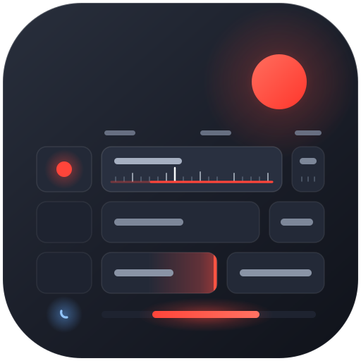
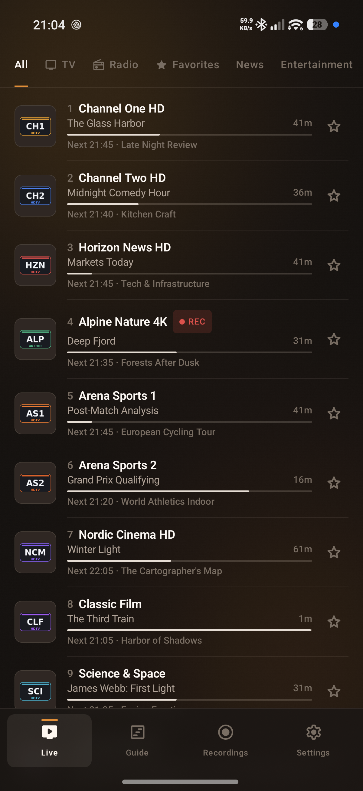
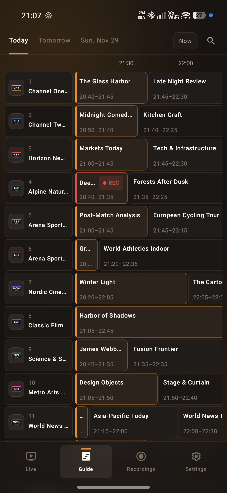
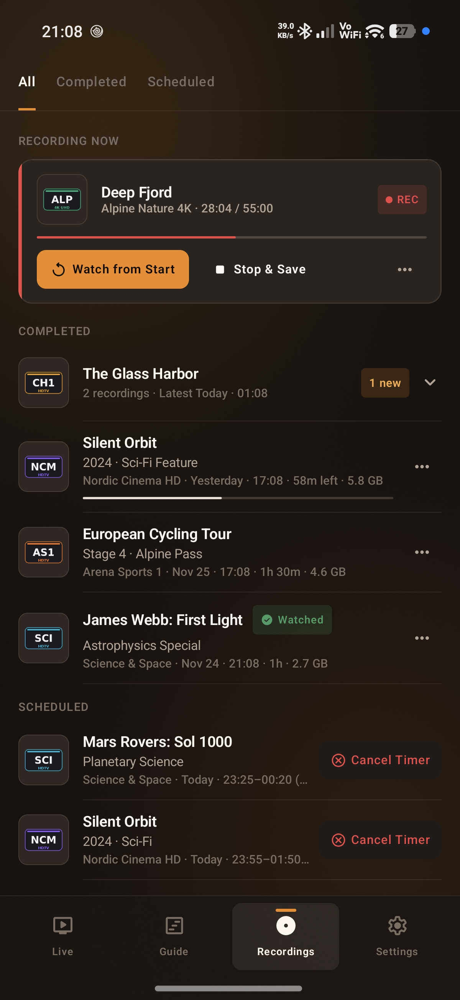
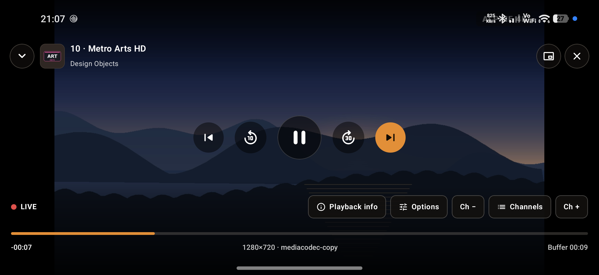
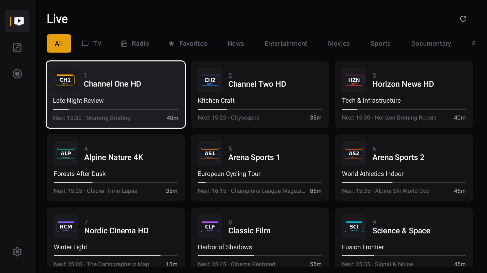
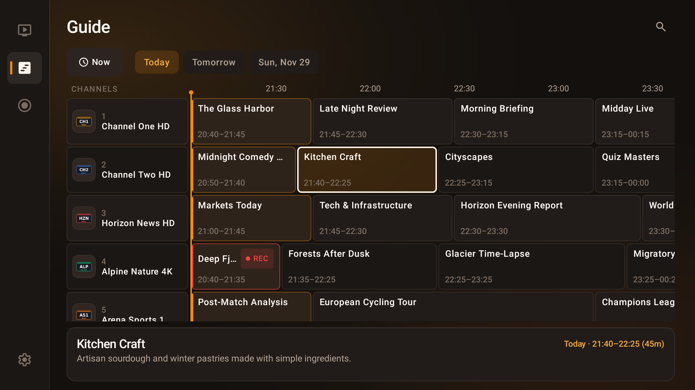
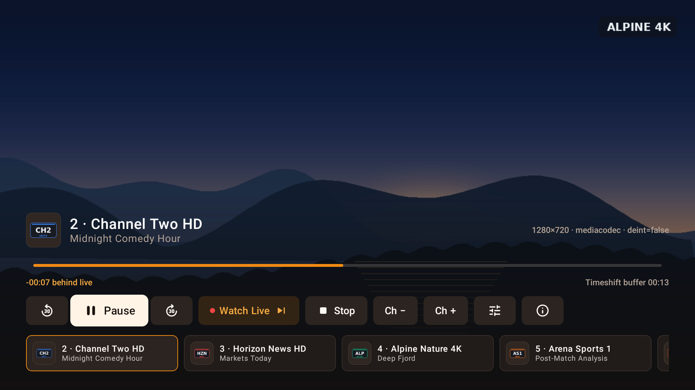
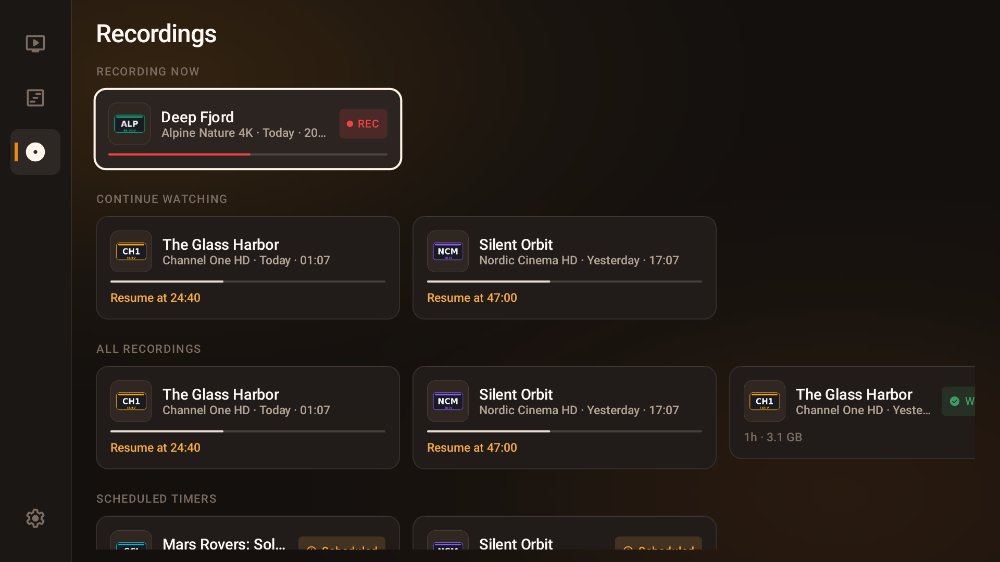

# MuxGrid — Tvheadend Client for Android & Android TV



A lightweight, native Android and Android TV client for **Tvheadend** (`4.3+`), built for sub-second channel zapping, local live pause/rewind (timeshift), smooth playback of completed and actively recording DVR shows, background audio playback on mobile, and a low-glare **Broadcast Monitor** dark interface (Carbon & Signal Amber).

Built as a **single unified codebase** producing ABI-split APKs for Android phones, tablets, and Android TV / Google TV devices (`minSdk 28`).

## Screenshots

### Android Phone
| Live Channels | Program Guide (EPG) | DVR & Recordings |
| :---: | :---: | :---: |
|  |  |  |

<p align="center">
  
</p>

### Android TV
| Live Channels | Program Guide (EPG) |
| :---: | :---: |
|  |  |
| **Live Player & Timeshift OSD** | **DVR & Recordings** |
|  |  |

## Features

- **Live TV & Radio:**
  - Instant channel zapping on LAN via Tvheadend's `pass` (MPEG-TS) stream profile with zero server-side transcoding.
  - Native broadcast decoding via `libmpv`: `1080i` interlaced H.264 (with `bwdif` software deinterlacing on mobile and zero-copy hardware decoding on TV), `MP2`/`AC3`/`AAC` audio track switching, and bitmap DVB subtitles (`DVBSUB`).
  - Channel filtering (`All`, `TV`, `Radio`, `Favorites`, and server channel tags), pull-to-refresh full metadata resync, and clear tuner-conflict notices on single-tuner servers.
- **Live Timeshift (Pause & Rewind):**
  - Disk-backed local `libmpv` ring buffer with configurable size limits in Settings (`Off`, `512 MB`, `1 GB`, `2 GB`, `4 GB`), free-space checks, and automatic recovery when pause reaches the forward buffer cap.
  - Buffered-range seekbar with `-MM:SS · Back to Live` quick jump.
- **Program Guide (EPG):**
  - **Phone & Tablet:** Vertical per-channel agenda with day tabs, expandable icon-triggered search, and program detail bottom sheet (**Watch Live**, **Record**, **Cancel Recording**).
  - **Android TV:** Horizontal timeline grid with sticky channel column, live "Now" hairline, top-bar program search, and a fixed-height bottom details bar for focused programs.
- **DVR & Recording Management:**
  - Dedicated sections/shelves for **Recording Now**, **Completed** (grouped by series/title), and **Scheduled** timers.
  - Schedule, stop, cancel, and delete recordings directly via HTSP.
  - **Watch from Start (Chase-Play):** Seamless playback and seeking of actively growing recordings over an in-process HTSP VFS tail-follow loopback proxy (`LocalMediaProxy`).
  - Server-side resume position (`playposition`) and watched state (`playcount`) synced across devices, with local fallback for read-only users.
- **Background Audio & Picture-in-Picture (Phone & Tablet):**
  - Media3 `MediaSessionService` foreground playback with lock-screen controls, Bluetooth/headset media keys, audio focus handling, headphone-disconnect pause, and Wi-Fi/partial wake locks.
  - Persistent mini-player bar, `vid=no` audio-only backgrounding for radio and live TV, and automatic/manual Picture-in-Picture (PiP).
- **Tailored Mobile & 10-ft TV Controls:**
  - **Mobile:** Double-tap seek (`-10s` / `+30s`), vertical edge drags for brightness and volume, aspect ratio selector, Quick-Zap channel drawer, adaptive tablet/landscape layout, and Haze backdrop blur on non-video chrome.
  - **Android TV:** Collapsible left Navigation Rail (`androidx.tv:tv-material`), instant `Ch+`/`Ch-` / D-pad Up/Down zapping with minimal OSD, progressive D-pad seeking (`10s → 30s → 1m → 5m → 10m` tap ladder with gear-locked continuous hold capped at `30s`), and an overlay Quick Channel Strip.

## Server Setup (Tvheadend)

MuxGrid requires **Tvheadend 4.3+** with both **HTSP (`9982/tcp`)** and **HTTP (`9981/tcp`)** reachable over your LAN or VPN, and the **`pass`** stream profile enabled.

See **[docs/SERVER_SETUP.md](./docs/SERVER_SETUP.md)** for a complete step-by-step guide covering:
- Stream profiles (`pass`, `htsp`, `matroska`) and DVR profile settings
- Creating a least-privilege Tvheadend user (full DVR vs. read-only permissions)
- Server-side vs. local timeshift, single-tuner considerations, and VPN remote access
- Verification commands (`curl`, `nc`) and troubleshooting

## Download & Install

Prebuilt signed APKs are published on **[GitHub Releases](https://github.com/corebonts/muxgrid/releases)** (`minSdk 28` / Android 9+):

- **Phone / Tablet / 64-bit Android TV (`arm64-v8a`):** `muxgrid-vX.Y.Z-arm64-v8a.apk`
- **32-bit Android TV (`armeabi-v7a`):** `muxgrid-vX.Y.Z-armeabi-v7a.apk`

Each release includes a `SHA256SUMS.txt` file for verifying APK integrity.

## Build & Install from Source

### Prerequisites
- **JDK 17**
- **Android SDK** with `compileSdk` **37.2** (`release(37)`, minor `2`) and build tools installed (or let Gradle download missing SDK components if configured)
- Target device running **Android 9 (API 28)** or newer

### Build & Run Tests

```bash
./gradlew test assembleDebug
```

ABI-split debug APKs are generated at:
- **Phone / Tablet / 64-bit TV (`arm64-v8a`):** `app/build/outputs/apk/debug/app-arm64-v8a-debug.apk`
- **32-bit Android TV (`armeabi-v7a`):** `app/build/outputs/apk/debug/app-armeabi-v7a-debug.apk`

### Sideload via ADB

```bash
adb install -r app/build/outputs/apk/debug/app-arm64-v8a-debug.apk
# or for 32-bit Android TV devices:
adb install -r app/build/outputs/apk/debug/app-armeabi-v7a-debug.apk
```

### Signed Release Builds (Optional)

To sign release builds (`./gradlew assembleRelease`), create a gitignored `keystore.properties` in the repo root:

```properties
storeFile=/path/to/your-release.keystore
storePassword=...
keyAlias=...
keyPassword=...
```

Alternatively, provide `MUXGRID_KEYSTORE_PATH`, `MUXGRID_KEYSTORE_PASSWORD`, `MUXGRID_KEY_ALIAS`, and `MUXGRID_KEY_PASSWORD` environment variables. Without signing credentials, `assembleRelease` produces unsigned minified APKs.

## Architecture at a Glance

```text
┌─────────────────────────────────────────────────────────────────────────┐
│                    Unified Android APK (Phone + TV)                     │
│                                                                         │
│  :feature:mobile (Compose M3)          :feature:tv (Compose for TV)     │
│                └──────────────┬───────────────┘                         │
│                               ▼                                         │
│      :core:data (Reactive StateFlow Store + DataStore Preferences)      │
│              ┌────────────────┴─────────────────┐                       │
│              ▼                                  ▼                       │
│  :core:htsp (Pure Kotlin TCP)        :core:player (PlaybackEngine)      │
│  • Channels, EPG, DVR push sync      • libmpv (1080i, MP2, DVBSUB)      │
│  • Auth tickets (getTicket)          • Live pause/rewind ring buffer    │
│  • fileOpen/Read/Stat (growing DVR)  • Media3 MediaSessionService + PiP │
└──────────────┬──────────────────────────────────┬───────────────────────┘
               │ HTSP (9982/tcp)                  │ HTTP (9981/tcp, pass / dvrfile)
               ▼                                  ▼
                    Tvheadend 4.3+ Server (LAN / VPN)
```

## Documentation

| Document | Purpose |
| :--- | :--- |
| [docs/SERVER_SETUP.md](./docs/SERVER_SETUP.md) | Step-by-step Tvheadend server configuration, ACL permissions, verification & troubleshooting |
| [docs/ARCHITECTURE.md](./docs/ARCHITECTURE.md) | Multi-module architecture, hybrid HTSP/HTTP proxy design, and verified platform/protocol notes |
| [docs/DESIGN.md](./docs/DESIGN.md) | Broadcast Monitor visual tokens, mobile/TV layouts, player HUD, gestures & D-pad rules |
| [docs/PROTOCOL.md](./docs/PROTOCOL.md) | Tvheadend HTSP binary wire format, RPC subset, and `LocalMediaProxy` contract |
| [CHANGELOG.md](./CHANGELOG.md) | Release and implementation history |
| [ROADMAP.md](./ROADMAP.md) | Planned features and upcoming platform work |

## Acknowledgments & Attribution

### Third-Party Projects & Libraries
- **[Tvheadend](https://tvheadend.org/)** — TV streaming server and the HTSP (Home TV Streaming Protocol) implemented by `:core:htsp`.
- **[mpv](https://mpv.io/)**, **[FFmpeg](https://ffmpeg.org/)**, and **[mpv-android-lib](https://github.com/abdallahmehiz/mpv-android-lib)** (by [Abdallah Mehiz](https://github.com/abdallahmehiz)) — Native Android `libmpv` playback engine, hardware decoding bridge, and `bwdif` deinterlacing filter.
- **[Haze](https://github.com/chrisbanes/haze)** (by [Chris Banes](https://github.com/chrisbanes)) — Real-time frosted-glass backdrop blur across mobile and tablet chrome.
- **[Coil 3](https://coil-kt.github.io/coil/)** & **[OkHttp](https://square.github.io/okhttp/)** — Channel picon fetching (HTSP VFS + HTTP Digest/Basic fallback) and image caching.
- **[Google Tink](https://developers.google.com/tink)** — Android Keystore-backed AEAD credential encryption.
- **[Google Material Symbols](https://fonts.google.com/icons)** — Rounded icon vector paths embedded in `:core:designsystem`.
- **[Android Jetpack](https://developer.android.com/jetpack)** & **[Kotlin Coroutines](https://github.com/Kotlin/kotlinx.coroutines)** — Compose, Compose for TV (`androidx.tv`), Media3 (`MediaSessionService`), and DataStore.

See [NOTICE](./NOTICE) for full third-party copyright and license notices.

### AI Assistance
Architected, researched, designed, and implemented with the assistance of **Google Antigravity** (powered by **Gemini**), including the clean-room HTSP protocol implementation, SVG iconography, and multi-module Kotlin/Compose codebase.

## License

- **Source Code ([LICENSE](./LICENSE)):** The original Kotlin source code, documentation, and assets in this repository are licensed under the **[Apache License, Version 2.0](./LICENSE)**.
- **Compiled Binaries / APKs:** Compiled builds link and bundle prebuilt `libmpv` and `FFmpeg` native binaries via `io.github.abdallahmehiz:mpv-android-lib:0.2.1` (built with `--enable-gpl --enable-version3`), so distributed APKs are governed by the **GNU General Public License v3.0 or later (GPL-3.0-or-later)**. Upstream source and build scripts for the bundled native libraries are available at [`abdallahmehiz/mpv-android`](https://github.com/abdallahmehiz/mpv-android), [`mpv-player/mpv`](https://github.com/mpv-player/mpv), and [`FFmpeg/FFmpeg`](https://github.com/FFmpeg/FFmpeg). The playback engine is isolated behind the `PlaybackEngine` interface in `:core:player` so the rest of the codebase remains modular and reusable under Apache-2.0.
