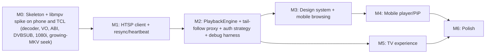

# Review: MuxGrid PLAN.md (+ PROTOCOL / SERVER_SETUP / DESIGN)

Files reviewed: [PLAN.md](file:///home/corebonts/dev/homelab-tvheadend/android-client/PLAN.md), [PROTOCOL.md](file:///home/corebonts/dev/homelab-tvheadend/android-client/docs/PROTOCOL.md), [SERVER_SETUP.md](file:///home/corebonts/dev/homelab-tvheadend/android-client/docs/SERVER_SETUP.md), [DESIGN.md](file:///home/corebonts/dev/homelab-tvheadend/android-client/docs/DESIGN.md), [README.md](file:///home/corebonts/dev/homelab-tvheadend/android-client/README.md) · Research references: [tvheadend-protocol-research.md](file:///home/corebonts/dev/homelab-tvheadend/android-client/researcher-tvheadend-protocol/tvheadend-protocol-research.md), [libmpv_android_research.md](file:///home/corebonts/dev/homelab-tvheadend/android-client/researcher-tvheadend-libmpv/libmpv_android_research.md)

**Overall:** The architecture holds up. HTSP for control, HTTP `pass` for media, libmpv instead of an ExoPlayer `muxpkt` bridge, an in-memory store, and a single APK are all good choices. The "Pitfalls" section is especially useful. My concerns are about the **playback layer** and a few **Tvheadend protocol edge cases** verified against upstream source. Also, the riskiest playback work is scheduled too late.

Legend: 🔴 must fix before implementation · 🟠 design gap · 🟡 minor / consistency. *(verified)* marks claims checked directly against Tvheadend, mpv, FFmpeg, Media3, or Maven Central artifacts/sources; remaining hardware items (TCL C635 / phone 1080i50 decode & growing-MKV linear seek) require the M0 device spike.

---

## 🔴 Critical

### 1. `hwdec=mediacodec` on TV skips mpv's deinterlacer, and `dev.jdtech.mpv:libmpv` strips `bwdif`
Zero-copy `hwdec=mediacodec` does **not** require `vo=mediacodec_embed` — in `mpv`, it also works with `vo=gpu` + `--gpu-context=android` (which is what `mpv-android` uses by default via `hwdec=mediacodec,mediacodec-copy`), so **DVBSUB subtitles and the OSD still work** under `vo=gpu` + `hwdec=mediacodec`. **However**, `hwdec=mediacodec` (`IMGFMT_MEDIACODEC`) still skips mpv's filter chain (`deinterlace=yes`/`auto` has no effect because `mpv` has no MediaCodec/GLES deinterlace filter), while `vo=mediacodec_embed` drops subtitles and OSD as well.
- **Fix:** Use `vo=gpu` + `gpu-context=android` + `hwdec=mediacodec-copy` as the baseline where mpv-side deinterlacing is needed, and test `hwdec=mediacodec` (`vo=gpu`) as the fast path on TCL C635 (since Realtek TV pipelines sometimes deinterlace internally when decoding via MediaCodec). Treat `vo=mediacodec_embed` only as an opt-in "no subtitles/OSD" fallback.
- **New risk & AAR blocker:** With `-copy` frames, `deinterlace=yes` inserts FFmpeg's **`bwdif` filter on the CPU** (`filters/f_auto_filters.c`) at 1440×1080i50, which may overload the TCL C635's quad-core Cortex-A55 @ 1.3 GHz. Worse, **`dev.jdtech.mpv:libmpv:1.1.0` compiles FFmpeg with `--disable-filters` and strips `bwdif`/`yadif` completely** (`io.github.cd16d:libmpv:1.1.0-filters.2` only adds audio filters, and `io.github.midasvo:libmpv:1.2.0` also uses `--disable-filters`). Use **`io.github.abdallahmehiz:mpv-android-lib:0.2.1`** (`mpv-android-lib-android:0.2.1`, JNI `is.xyz.mpv.*`), which keeps `bwdif`/`yadif` enabled, or compile a custom AAR with `bwdif` enabled.

### 2. Move the playback de-risking spike to M0
The AAR/codec unknowns have now been checked against Maven Central ([libmpv_android_research.md](file:///home/corebonts/dev/homelab-tvheadend/android-client/researcher-tvheadend-libmpv/libmpv_android_research.md)):
- **AARs & codecs:** Both `io.github.abdallahmehiz:mpv-android-lib:0.2.1` (~17.0 MB `armeabi-v7a` / ~18.3 MB `arm64-v8a` compressed + ~2.9 MB `assets/subfont.ttf`, JNI `is.xyz.mpv.MPV`) and `dev.jdtech.mpv:libmpv:1.1.0` (~11.5 / ~12.0 MB compressed, JNI `dev.jdtech.mpv.MPVLib`) ship all 4 ABIs (`arm64-v8a`, `armeabi-v7a`, `x86`, `x86_64`), include `h264`, `hevc`, `mpeg2video`, `mp2`, `ac3`, `eac3`, `aac`, `aac_latm`, `dvb_subtitle`, `dvb_teletext`, `mpegts`, `matroska`, and `http`/`https`, and are **GPL-3.0-or-later** (`--enable-gpl --enable-version3` in `libavutil.so`, even though `mehiz`'s POM lists MIT for the Kotlin wrapper). Only `mehiz` keeps `bwdif`/`yadif`.
- **TCL C635 hardware & ABI:** Realtek `RTD2851` (`RT51M` chassis, Cortex-A55 @ 1.3 GHz, Mali-G31 MP2, 2 GB DDR, Android TV 11) commonly runs a **32-bit-only (`armeabi-v7a`) userland** despite 64-bit cores. Verify `adb shell getprop ro.product.cpu.abilist` on the TV and use ABI splits (`armeabi-v7a`, `arm64-v8a`).

What still **must** be tested on hardware in an **M0 spike** (a bare Activity with a `SurfaceView` and `libmpv` playing a hard-coded `?profile=pass` URL on both the phone and TCL C635):
- `hwdec=mediacodec` (`vo=gpu`) vs `hwdec=mediacodec-copy` + `deinterlace=yes` (`bwdif`) for 1080i50 smoothness, combing, CPU, and RAM;
- `DVBSUB` bitmap rendering, audio-track switching, and growing-MKV seeking. Lock the decoder/VO preset from those results before M2.

### 3. The growing-recording proxy contract still hits EOF
[PROTOCOL §4](file:///home/corebonts/dev/homelab-tvheadend/android-client/docs/PROTOCOL.md#L115-L119) calls `fileStat` on each request, then answers with `206` and a total size. FFmpeg (`libavformat/http.c`) stores that total in `s->filesize` / `s->oc_filesize`, refuses seeks past it, and reports `AVERROR_EOF` once reached. That is the same "frozen Content-Length" bug the proxy is meant to fix, just moved into the proxy.
- **Fix:** Use **tail-follow semantics**. Verified in FFmpeg `libavformat/http.c`: replying with **`Accept-Ranges: bytes`** and **`Content-Range: bytes X-Y/*`** (unknown total, or `Transfer-Encoding: chunked` without a known total) sets `h->is_streamed = 0` while keeping `s->filesize = UINT64_MAX`, so `SEEK_SET`/`SEEK_CUR` still work without prematurely capping EOF (`AVSEEK_SIZE` and `SEEK_END` return `ENOSYS`). Also note FFmpeg treats `416` on an unknown-size resource as EOF (`is_end_of_resource()`), so when `fileRead` returns short at the write head while `state == "recording"`, poll `fileStat` every ~500 ms and keep streaming rather than returning `416`. Close the stream only when the DVR entry becomes `completed`/`missed`, or when the client disconnects.
- Add JVM tests for these cases: a read at the write head, a range starting past the current size (wait or clamp, not `416`), and the client disconnecting mid-read (must call `fileClose`).

### 4. Growing MKV has no seek index while recording *(verified; test seek behavior in M0)*
In Tvheadend's `src/muxer/muxer_mkv.c`, `mkv_muxer_init` writes an EBML unknown Segment size (`0x01FFFFFFFFFFFFFF`) and a 500-byte `Void` placeholder instead of `SeekHead`. **`Cues`, `MetaSeek`/`SeekHead`, `Duration`, and the final Segment size are written only once in `mk_mux_close()`**—there is no option for periodic cues. Also, HTTP `/dvrfile/<id>` (`http_serve_file`) snapshots `fstat` once at open and returns an HTML `200` (not `416`) on out-of-bounds/suffix ranges. SERVER_SETUP's claim of "clean seeking for … in-progress recordings" via `matroska` therefore depends on FFmpeg/libmpv scanning clusters linearly.
- In the M0 spike, test seeking in a live recording through `fileRead` (via the tail-follow proxy). If linear scan is too slow or stalls, compare against a DVR profile using `pass` (MPEG-TS, seekable by byte position). Check Jellyfin's handling of `.ts` before changing the server profile.

### 5. HTTP tickets expire (300 s default) *(verified)*
In `src/config.c` / `src/access.c`, `ticket_expires` defaults to **300 s** (configurable 30–3600 s). Tickets are **reusable** within their lifetime, and an already-open stream keeps running past expiry (because `hc->hc_access` holds a copy). Problems that follow:
- **Seeking:** mpv/FFmpeg sends new Range requests when you seek in a completed recording. After expiry these fail with `401` (unless another auth method succeeds).
- **Reconnect:** FFmpeg's reconnect on a live stream fails the same way.
- **Fix:** Pick one approach and say so in the plan:
  - (a) send **every** media URL through the loopback proxy, which fetches a fresh ticket per upstream request;
  - (b) pass `http-header-fields: Authorization: …` to mpv (note: Tvheadend 4.3 defaults to **Digest MD5**, so verify FFmpeg's Digest handling or don't assume Basic works); or
  - (c) use Tvheadend 4.3's per-user **persistent auth** (`?auth=<code>`, introduced in 4.3, accepted on `/stream`, `/dvrfile`, and `/imagecache` with rights masked to `ACCESS_STREAMING | ACCESS_ADVANCED_STREAMING`). Requires enabling persistent auth per user in Tvheadend's Passwords tab.

  Pitfall #4 currently rules out (b) implicitly; it should be reconciled with whatever you choose.

### 6. Pausing live TV is limited by the *forward* buffer, not the back buffer
Verified in `mpv` `demux/demux.c` (`read_packet()`): while paused, `demux_thread` keeps prefetching until `demuxer-max-bytes` (forward) fills up, then stops reading from the socket. Tvheadend then sees a stalled HTTP client and eventually drops the subscription.
- **Window size & disk cache caveat:** At DVB-T HD bitrates (~8–10 Mbit/s), 128 MiB is only about **100–130 s**. M2's "pause 60 s" passes, but any longer pause breaks. Also note per `mpv` `DOCS/man/options.rst`: `--cache-on-disk=yes` uses an **append-only** temp file (pruned space is not reused until playback closes), and **packet metadata still lives in RAM** (~50 MB/hour) governed by `--demuxer-max-bytes` / `--demuxer-max-back-bytes`.
- **Fix:** State a target timeshift window explicitly, for example 30 min ≈ 2 GB on disk (~25 MB RAM metadata; test storage headroom on the 16 GB TCL C635). Size both `demuxer-max-bytes` and `demuxer-max-back-bytes` with `cache-on-disk=yes` and `demuxer-cache-dir=<appCacheDir>`, set `demuxer-seekable-cache=yes` explicitly (already `auto`→`yes` when `cache=yes`), tear down playback cleanly on zap so the temp file is deleted, and define the UX when the buffer limit is reached (auto-resume, or jump to live on reconnect).

---

## 🟠 Design gaps

7. **Network Security Config can't express RFC1918 ranges; Android 17 enforces `ACCESS_LOCAL_NETWORK`.** `<domain-config>` matches hostnames or exact IPs, not CIDR blocks ([M0](file:///home/corebonts/dev/homelab-tvheadend/android-client/PLAN.md#L96)). Also, NSC only affects Java HTTP stacks (OkHttp/Coil); libmpv/FFmpeg and the raw HTSP socket ignore it. Use `base-config cleartextTrafficPermitted="true"`, or drop Java HTTP entirely (see #9). Separately, **Android 17 (`targetSdk >= 37`)** enforces `android.permission.ACCESS_LOCAL_NETWORK` (`NEARBY_DEVICES` runtime permission group) in the OS networking stack, blocking **both Java and native NDK sockets** (`libmpv`/FFmpeg and HTSP TCP `9982`) to `192.168.x.x` / `.local` unless declared and granted at runtime (apps targeting API ≤ 36 retain the implicit `INTERNET` grant).
8. **Media3 won't handle AudioFocus, noisy-audio pauses, or wake/wifi locks for a custom `SimpleBasePlayer`.** Verified in `androidx/media`: `AudioBecomingNoisyManager`, `AudioFocusManager`, `WakeLockManager`, and `WifiLockManager` live inside `ExoPlayerImpl`, not `MediaSessionService` or `SimpleBasePlayer`. You need to implement `AudioFocusRequest`, the `ACTION_AUDIO_BECOMING_NOISY` receiver, a **WifiLock** and a partial WakeLock yourself for screen-off radio. Without the WifiLock, Wi-Fi power-save will stall the stream. Pitfall/M6 currently only mention screen-on locks.
9. **Picons need authentication and `fileOpen` has a DVR-permission catch *(verified)*.** `getTicket` only covers channels and DVR entries, so `/imagecache/<id>` over HTTP requires auth once the default `*` ACL is removed (4.3 defaults to Digest MD5, and accepts `?auth=<code>` + `ACCESS_STREAMING`/`ACCESS_HTSP_STREAMING`). Switching to a **custom Coil `Fetcher` backed by HTSP `fileOpen`** removes Java HTTP and #7—**however**, in `src/htsp_server.c` all `file*` methods (`fileOpen`, `fileRead`, `fileStat`, `fileSeek`, `fileClose`) require **`ACCESS_HTSP_RECORDER`** (`HTSP DVR`), NOT `ACCESS_HTSP_STREAMING`. A read-only TV user without `HTSP DVR` rights (as suggested in [SERVER_SETUP.md](file:///home/corebonts/dev/homelab-tvheadend/android-client/docs/SERVER_SETUP.md#L49-L50)) will get `noaccess=1` on `fileOpen("imagecache/...")`. Also note `htsp_image()` returns `"imagecache/<id>"` (no leading slash) at `htspversion >= 15`, `"/imagecache/<id>"` at `8..14`, or a raw external URL if uncached—so the Coil fetcher must handle both `imagecache/<id>` and `http(s)://` URLs, and either document that `HTSP DVR` is required or fall back to authenticated HTTP for streaming-only users.
10. **Store resume positions on the server, not in DataStore *(verified)*.** HTSP DVR entries carry `playposition` (in **seconds**) and `playcount`, and `updateDvrEntry` (plus `fileClose`) sets them starting in **HTSP v26/v27** (`4.2.8` is v27; `master` is v44). That lets phone and TV share "Continue Watching" and the watched state. Keep a local DataStore fallback only if supporting read-only users without `ACCESS_HTSP_RECORDER`.
11. **Define the reconnect / resync mechanism in M1, not M6 *(verified)*.** HTSP has no `ping` method and **no server-side idle timeout** (`htsp_read_message(..., 0)` blocks indefinitely), so use periodic `getSysTime` (which also detects TV clock skew) plus TCP keepalive. Deletes that happen while disconnected are lost, so re-run `enableAsyncMetadata` into a **shadow store and swap atomically** on `initialSyncCompleted`. Also decide when to *close* the HTSP socket (app backgrounded and not playing) to save battery.
12. **RPC list *(verified)*.** `stopDvrEntry` (**HTSP v25+**) stops an active `recording` cleanly (`SM_CODE_OK` -> `completed`, no-op on other states); `cancelDvrEntry` (**v5+**) cancels `scheduled` entries *and* aborts active `recording` entries (`SM_CODE_ABORTED`, marking autorec `dont_rerecord`); `deleteDvrEntry` (**v4+**) aborts/deletes files and removes or expires the entry; `removeDvrEntry` does not exist. All require `ACCESS_HTSP_RECORDER`. "Autorec" appears in the §1.1 table, but no milestone builds it—either schedule it or remove it.
13. **Detecting a single-tuner conflict *(verified)*.** When no free tuner is available, HTTP `/stream/channelid/<id>` does **not** return `503`: `subscription_reschedule()` retries for ~2 s (`SMT_NOSTART`), then `http_stream_channel()` overwrites `res = 0` and closes the TCP socket with **0 bytes / empty reply** (no HTTP status line). mpv will therefore report an EOF/load failure after ~2 s, never `503`. Trigger the heuristic on **any** live-stream open failure: check HTSP for a `dvrEntry` in `state == "recording"` on another channel, then show the notice with that entry's name. Write acceptance criteria separately for same-mux zaps (fast) and cross-mux zaps (+1–2 s of retune time).
14. **Frosted glass over video isn't possible.** Compose backdrop blur, whether Haze (`2.1.0`) or `RenderEffect`, can't sample a **SurfaceView**, which is where mpv renders (and switching to `TextureView` adds GPU copy overhead that hurts 1080i50 playback on the TCL C635's Mali-G31 MP2). Compose `1.13.0`'s native progressive blur (`Modifier.blur(BlurRadiusSpec...)`) is a self/layer blur only, not a backdrop blur. Make translucent scrims the *default* for the player HUD and OSD. Keep Haze/blur for non-video screens. Window-level blur is often disabled on low-end TVs.
15. **M2 acceptance has no UI to run on.** Phone and TV testing comes before M3/M5, so add a minimal debug harness to M2 (channel list → play, recording list → play).
16. **M0 manifest additions:** `android:banner` is required with `LEANBACK_LAUNCHER`. Also add `<uses-feature android:name="android.software.leanback" android:required="false"/>`.
17. **Credential storage:** `androidx.security:security-crypto` (`1.1.0`) / `EncryptedSharedPreferences` is officially deprecated. Specify **Jetpack DataStore (`1.3.0`) + Google Tink (`com.google.crypto.tink:tink-android:1.24.0`)** with a Keystore-backed AEAD. Note that the password itself must be stored, because the SHA-1 challenge needs it on every reconnect.

---

## 🟡 Minor / consistency

- [PLAN Pitfall #2](file:///home/corebonts/dev/homelab-tvheadend/android-client/PLAN.md) uses `schedStatus == "recording"`. That's an HTTP-API field; HTSP uses `state` (as PROTOCOL.md says).
- SERVER_SETUP names the user `androidtv` in §1 but `androidclient` in Step C. The tuner is called "IT9135" in one place and "Afatech AF9033" in another.
- The SERVER_SETUP curl check uses `-I` (HEAD) plus Basic auth, but Tvheadend 4.3 defaults to **Digest MD5** (`HTTP_AUTH_DIGEST` in `src/config.c`). Use `--anyauth` with a GET: `curl -s -o /dev/null --max-time 3 -w '%{http_code} %{content_type}\n'`.
- Server timeshift only applies to **HTSP `subscribe` subscriptions** (`http_stream_channel` uses `profile_chain_open`, never `profile_chain_work` with `timeshiftPeriod`). Because this client streams over HTTP, Step D matters only for Kodi. Say so to avoid confusion.
- HTSP binary codec (`src/htsmsg.h`, `src/htsmsg_binary.c`): wire types are `1`=`MAP`, `2`=`S64`, `3`=`STR`, `4`=`BIN`, `5`=`LIST`, `7`=`BOOL` (**native type 7—`true` is 1 byte `0x01`, `false` is `dataLen = 0` empty payload**), `8`=`UUID` (**native type 8, 16 bytes**). `6`=`DBL` is **never sent on the wire** (`htsmsg_binary_write` calls `abort()` on `HMF_DBL`!). Decode `1–5`, `7`, `8` and skip unknown types by `dataLen` instead of failing. Negotiate `htspversion` as `min(client, server)`; `master` reports **44** (`4.2.8` reports **27**, `4.0` reports **20**).
- `dvrEntry` `state` is still actively sent (`scheduled`, `recording`, `completed`, `missed`, `invalid`), alongside `error`, `subscriptionError`, `streamErrors`, `dataErrors`, `dataSize`, and `duplicate`.
- Library versions verified against Google Maven / Maven Central (2026-11-20): `androidx.compose:compose-bom:2026.11.01` (Compose `1.13.0`, Material3 `1.5.0`), `androidx.tv:tv-material:1.1.0`, `androidx.media3:media3-session:1.11.1`, `io.coil-kt.coil3:coil:3.6.3`, `androidx.navigation:navigation-compose:2.10.2`, Kotlin `2.4.21`, AGP `9.5.2`, `androidx.datastore:datastore-preferences:1.3.0`, `com.google.crypto.tink:tink-android:1.24.0`, `dev.chrisbanes.haze:haze:2.1.0`. Note that Compose `1.13.0`'s native progressive blur (`Modifier.blur(BlurRadiusSpec...)`) is self-layer only (not backdrop blur behind floating bars).
- Pitfall #4 and Decision 1.1 should explicitly mention the outcome of #5 (tickets vs. headers vs. proxy).

---

## Suggested milestone reshuffle

M5 depends only on M2/M3 shared pieces, so the TV and mobile UI can run in parallel.
